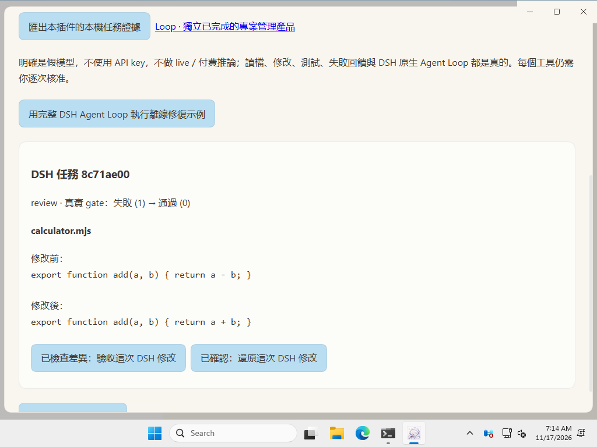

# 湛箴_ymzz


**The complete DeepSeek Harness application, with a small native ymzz plugin extension, our name/icon and four Wenrun themes. Not a rewritten agent runtime.**

> 深淵的清澈的水，纂刻于竹篾上的痕，珍重微小，有所依據，立傳傳世

[Official website](https://ya-mic.github.io/ymzz/) · [繁體中文](README.zh-Hant.md) · [Releases](https://github.com/Ya-MiC/ymzz/releases) · [Separate completed Loop product](https://ya-mic.github.io/ymzz-loop/)

## Download / current status

| Platform | Availability |
|---|---|
| Windows x64 | **Not released.** Real installer, Chinese-space installation and actual GUI task acceptance/memory/rollback passed; theme/settings GUI follow-up and licensing holds remain. |
| macOS / Linux desktop | Planned; not guaranteed in v0.1. |
| From source | Full DSH eight-gate artifact build and authenticated HTTP200 passed on Linux; actual native-agent tool/task tests passed. |

[Measured baseline](ymzz/docs/evidence/m2-baseline.json) · [Real full-DSH task evidence](ymzz/docs/evidence/full-dsh-product-web.json) · [Windows release hold](ymzz/docs/WINDOWS-BLOCKERS.md)

No old Tauri/Loop installer is presented as this product. No live/paid/NIM inference has been performed. A deterministic fake model is explicitly labeled fake; its real DSH agent loop, tool approvals, file patches and failing→repair→passing Node tests are not mocks.

## Three-step source setup

Node≥24.9, Git≥2.26 and Corepack-enabled **pnpm11.28.5**, exactly pinned upstream. From the repository root:

```sh
pnpm install
pnpm run build:artifacts
pnpm exec node ymzz/scripts/dev.mjs --no-open --port 3081
```

Open the private launch link printed locally; never publish its authentication token. The launcher runs the official DSH CLI and isolates source-run data under `~/.ymzz` (`YMZZ_HOME` overrides it); no registry edits or alternate runtime. The original `pnpm dsh web` remains available and uses upstream `DSH_HOME` behavior.

## Native plugin map

One private workspace package, [`@ymzz/dsh-product`](packages/ymzz/product), is loaded by the **full** DSH web/desktop composition. Original DSH navigation, chat, workspace/file panels, model settings, tools and plugin system remain in their native positions.

| Extension | What actually exists |
|---|---|
| Brand / Wenrun | Original user SVG and generated icons; exact product title/EXE resource branding; native sidebar brand/footer slots and four registered themes: 雲箋淺、雲箋暗、陶土淺、陶土暗. Native PE ProductName/installation and all7 exact owner ICO resources passed; complete theme/settings GUI follow-up remains. |
| Bounded task / gates | Official `ctx.agents`, `ctx.tools`, `ctx.approval`; explicit proposals, selected-workspace read/write/patch, fixed Node test command, failure feedback, human diff accept/rollback, persistent tasks and confirmed memory. Not an OS/network sandbox. |
| Local provider | Off-by-default loopback OpenAI-compatible adapter/settings; no API key handling or remote URLs. Protocol tests use labeled fake HTTP responses. A working real model is not claimed. General project picking uses the actual native DSH directory-picker service; Windows picker GUI remains unqualified. |
| Skills |9 integrity-pinned instruction skills registered with official `ctx.skills`; third-party licenses retained. Scripts/CLI installs/network permission are NOT granted by installing instructions. |
| Reviewed updates | Tested signature/hash/compatibility/license-checked local staging and staging rollback only. No live channel, installer/restart or maintainer signing key configured. |

On Windows first-run, use native **Add API Key → Set up later** to enter without credentials; no model is thereby configured. First plugin opening asks for a nickname; without a consented real phone suffix the default is simply 用戶, never invented digits. User model setup remains explicit. Payment is owner-managed and outside this work.

## Separate products stay separate

**Loop is a completed, independent project-management product.** Its website is a visual reference only; no Loop runtime, Tauri app, data, installer or migration is imported into this Agent. Existing 稟冊 and other prior software/sites/downloads remain in their own repositories, unchanged.

[Loop](https://ya-mic.github.io/ymzz-loop/) · [Independent evaluation site](https://bingce.yanmingx0215.filegear-sg.me/#onboarding) · [Preserved previous repository](https://github.com/Ya-MiC/ymzz-zhanzhen) · [Historical read-only asset verification](ymzz/docs/LEGACY-PRODUCTS.md)

## Development / provenance

Only `master`. All34 inherited workflows stay disabled; only narrowly scoped ymzz workflows are enabled. No upstream file is deleted, no `@deepseek-ai/*` package is renamed, and no custom agent core replaces DSH. Added code is under `ymzz/` and `packages/ymzz/`; upstream changes are documented branding, necessary package registrations and the owner-approved two unsigned Windows policy conditionals (signed validation retained).

```sh
node --test packages/ymzz/product/tests/*.test.mjs
node ymzz/scripts/check-site.mjs
node ymzz/scripts/audit-production.mjs --enforce
```

The last command **fails closed until actual native payload/source compliance clears**, even when the exact owner-approved LGPL/MPL graph passes. A deeper native NumPy audit found a separate GCC-runtime exception requiring a decision; it is not confused with plain GPL and is not silently approved. [Approved scope and remaining compliance qualification](ymzz/docs/WINDOWS-BLOCKERS.md).

[Actual source/compliance materials](ymzz/compliance/REBUILD.md) · [Branding points](ymzz/docs/BRANDING-POINTS.md) · [Network/disable controls](ymzz/docs/NETWORK.md) · [Skills/provenance](ymzz/docs/SKILLS.md) · [Upstream sync](ymzz/docs/UPSTREAM-SYNC.md) · [Original README](ymzz/docs/upstream/README.md) · [All source links](ymzz/docs/RESOURCES.md)

Based on DeepSeek Harness (MIT). **Not an official DeepSeek product.** Added code is MIT; actual third-party licenses remain applicable. [LICENSE](LICENSE) · [NOTICE](NOTICE.md) · [Upstream notices](THIRD_PARTY_NOTICES.md).

### Native Windows packaging (qualification, not publication)

```powershell
node ymzz/scripts/stage-notices.mjs
pnpm run package:desktop:win:x64:unsigned --check
pnpm run package:desktop:win:x64:unsigned
```

Use a Windows x64 build host and documented public `.env.windows` product settings. No mandatory-update endpoint is required for unsigned builds; signed HTTPS validation remains. Normal upstream NSIS install/uninstall/protocol registrations are not called “registry free”. [Measured installer-producing Windows attempt](https://github.com/Ya-MiC/ymzz/actions/runs/44035093932) built the real installer; the final native GUI/compliance gates are not yet green, so there is deliberately no executable download.

### Latest actual installed GUI task evidence

[Exact-code Windows proof](ymzz/docs/evidence/windows-44035093932/README.md): **12 real GUI tool approvals, two actual failing→repair→passing Node test sequences, human acceptance,1 explicit memory and rollback passed** in the official NSIS-installed full DSH, with Chinese-space paths, real bundled Node and all7 actual PE owner-icon resources verified. Model transport is explicitly fake, not live inference. Native theme-selection/settings GUI and license/source qualification remain incomplete; overall CI is not green and there is no installer download or Release.



### Current follow-up qualification

[Actual installed run44098435114](ymzz/docs/evidence/windows-44098435114/README.md) built/installed the official branded NSIS app in a Chinese-space path, passed real GUI tasks again, and **qualified the actual production MIT XSL resource hashes plus native RNG/XSD Schematron extraction/assertions**. Full GUI still failed before theme keyboard input because the test redundantly called Collapse on an already collapsed native select; no theme/settings pass is claimed.

[Follow-up44101906821](https://github.com/Ya-MiC/ymzz/actions/runs/44101906821), exact candidate `ff465dd39987ecf14e97e374bf531d622d45b889`, again passed real installed GUI tasks and MIT XSL checks but **failed native combo focus**; native Settings/plugin inventory were not reached. The next regression physically clicks the hit-tested real combo, accepts its genuinely focused popup option, and retains actual background plus four-palette accent pixel assertions. Owned Wenrun foreground consumption now uses readable paper text and warm-dark ink on dark-mode pastel buttons; all original palette tokens/native layout remain intact. A separate source-only LGPL relink check does not replace the Agent build. A private draft release is prepared **without an installer**; public installer downloads remain unavailable until qualification and remaining source/policy holds clear. [Precise source/compliance findings](ymzz/docs/LICENSE-FOLLOWUP.md). Loop is independent and untouched.

**Office/commercial:** real upstream DSH Office provider passed DOCX→PDF/PNG/ODT and actual XLSX formula recalculation on Linux/WASM0.2.3, without mocks or inference. Windows installed native equivalence is newly registered, not yet claimed. MPL permits commercial use with obligations; exact0.2.3 preferred-source completeness and the separate GCC-exception owner policy still block binary release. [Precise functional and commercial finding](ymzz/docs/OFFICE-COMMERCIAL.md).


### Latest measured milestone —2026-11-18 KST

[Installed44210430029](ymzz/docs/evidence/windows-44210430029/README.md) now passed **all four physical native theme background/accent assertions** and **real installed native Office0.2.3 PDF/PNG/ODT/formula operations with bundled Node**. Actual DSH GUI task acceptance/memory/rollback passes again. This is still NOT a Release: dark prose remains visibly low-contrast and native Settings validation stopped at an unsupported assumed menu Invoke pattern. Both are fixed in the next bounded qualification, including strict painted-text-ink assertions; no success is prefilled. [Commercial permission vs exact remaining source obligations](ymzz/docs/OFFICE-COMMERCIAL.md).
