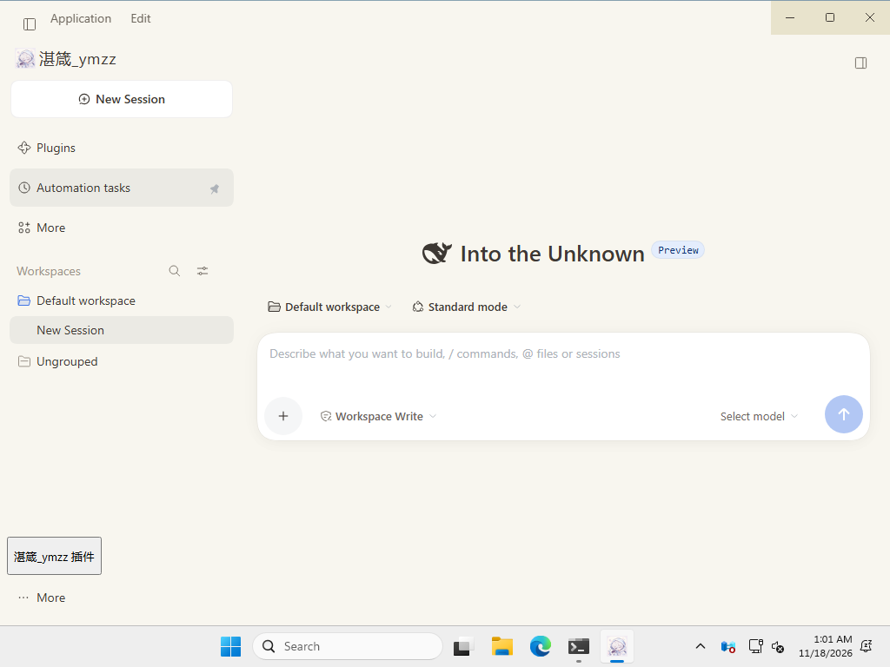

# Actual installed Windows run44210430029 — partial GUI, not Release clearance

2026-11-18 KST. [Run](https://github.com/Ya-MiC/ymzz/actions/runs/44210430029), exact application `447537fcaaecb4eca3057997b4426730330fd130`, completed10:03KST with overall FAILURE.

- Real official unsigned NSIS built and installed in the requested Chinese-space path; exact ProductName/owner PE icon frames and actual bundled Node24.21.0 pass.
-12 real GUI tool approvals, actual fail→repair→pass Node tests, human diff acceptance,1 explicit memory and actual rollback pass. Model transport remains explicitly fake.
- All FOUR real physical select interactions now pass immutable authority BACKGROUND AND ACCENT pixel assertions, with actual focused native combo/list-item identity recorded.
- **Not a full readable-theme pass:** the dark screenshot still reveals low-contrast prose. The next fix synchronizes owned body/dialog scheme markers and adds mandatory PAINTED authority-ink pixel assertions, not just background/accent checks. This image is preserved as failure evidence, not a marketing proof of accessible contrast.
- Native sidebar plugin slot and original full DSH workspace are visible. Settings failed because the test demanded InvokePattern for `Account menu`: the actual enabled button is in the accessibility snapshot but menu/disclosure controls can expose another pattern. The next test physically hit-tests/clicks the actual visible menu and plugin disclosure row. Settings/Models/plugin inventory are NOT yet claimed qualified.
- **Actual installed Office native engine0.2.3 passed independently**, using actual extracted app.asar resources and bundled Node24.21.0: DOCX→PDF, real PNG, ODT retained text, and XLSX stale0→formula5. No mocked converter or inference. Exact ASAR/Node hashes in office-actual.json.
- Actual installed MIT Schematron transforms pass again. NumPy GCC-exception policy and Office preferred-source completeness still HOLD. No installer uploaded/published.

## Actual installer/executable hashes

```json
{
  "actualNSISInstalled": true,
  "exeSHA256": "DC4B012A1C0D642740C01367D853C91D7969B07C1021E99C5C79558B93C73DDC",
  "nodeVersion": "v24.21.0",
  "installerSHA256": "C9DF755AB1A308503BC800EA5E87E814294506EA3631CB17AC4EB2C35205EC99",
  "productName": "湛箴_ymzz",
  "primaryNodeSHA256": "BA4E6D110E8C1592A1ECD390F6B05F3DA124B13871A5BE62B341A07A853C6C32",
  "unicodeSpaceInstallPath": true,
  "nativeGUIQualified": false
}
```


